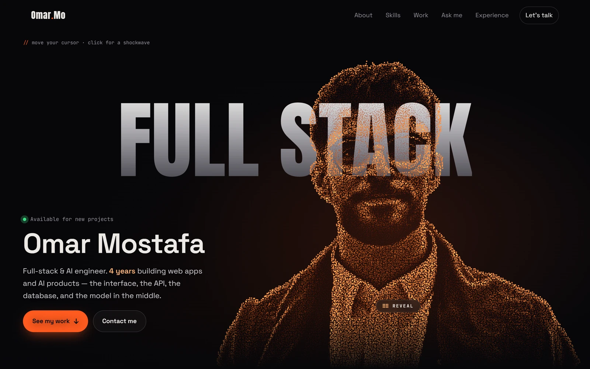

# Omar Mostafa — Portfolio

Personal portfolio of Omar Mostafa, full-stack & AI engineer.

**Live:** https://microbe233.github.io/profile/

## Highlights

- **Particle portrait** — ~22k dots generated from a photo (AI background removal + Python), drawn on a canvas at 60fps. A different intro animation on every visit; the dots react to the cursor or touch, and "Reveal" swaps to the real photo.
- **Ask me** — a small search engine (BM25) that answers questions about my skills, projects and experience, and shows how it found each answer.
- **Interactive terminal** — try `help`, `skills ai`, `projects` or `open 1`.
- **Work** — case studies with real screenshots, filters and galleries.
- Responsive from phones to desktops; respects reduced-motion settings.

## Built with

Plain HTML, CSS and JavaScript — no frameworks, no build step. Self-hosted fonts and icons, no third-party requests.

## Security

Follows the OWASP cheat sheets for static sites:

- strict Content Security Policy (no inline scripts or styles)
- visitor input is only ever inserted as text, never as HTML
- links from the content file are checked against an allow-list (no `javascript:` URLs)
- security headers in [`_headers`](_headers) for hosts that support them (Netlify, Cloudflare Pages)

## Editing the content

Everything shown on the site — projects, skills, experience and links — lives in [`js/data.js`](js/data.js).

## Credits

Fonts: Anton, Space Grotesk, JetBrains Mono (SIL Open Font License) · Icons: Font Awesome Free · Aerial imagery in the GPS project: NYS ITS Geospatial Services.
